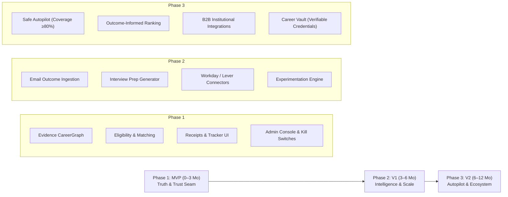
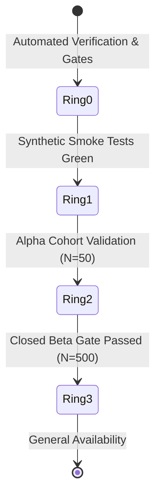

# NextJob Product Rollout Plan

**Document Version:** 1.0.0  
**Authority:** [PRD.md](file:///c:/Users/basem/Desktop/Dev/nextjob/docs/PRD.md) (§FR-ROL-01, §FR-ROL-02, §FR-ROL-03) and [TECH.md](file:///c:/Users/basem/Desktop/Dev/nextjob/docs/TECH.md)  
**Status:** Approved for Implementation

---

## Executive Summary

NextJob delivers a trustworthy, evidence-grounded AI career agent that converts verified candidate career history into eligible, high-converting job applications. Unlike generic auto-apply bots that spam applicant tracking systems (ATS) with fabricated claims, NextJob operates on three unbending pillars:
1. **Zero Hallucination:** Every factual statement traces directly to a verified `CareerClaim`.
2. **Eligibility-First:** Hard gate eligibility validation before ranking; false-positive rate $\le 2\%$.
3. **Provable Integrity:** Cryptographic submission receipts (SHA-256 content and field hashes) with immutable audit provenance.

This rollout plan establishes the progressive delivery schedule across three distinct phases: **Phase 1 (MVP)**, **Phase 2 (V1 Growth & Intelligence)**, and **Phase 3 (V2 Safe Autopilot & Ecosystem)**.

---

## Phase 1: MVP — The Trust & Proof Foundation (0–3 Months)

### Objective
Ship the end-to-end trustworthy application loop for individual job seekers and supervised institutional cohorts. Establish complete user consent, evidence provenance, human-in-the-loop approvals, and verifiable receipts.

### Requirements & PRD Mapping (FR-ROL-01)
* **Identity & Authentication (T-04, FR-ONB-01):**
  * Supabase OAuth 2.0 (Google, GitHub, Email Magic Link).
  * Multi-tenant data isolation with row-level security (RLS) and role-based access control (`candidate`, `coach`, `org_admin`, `platform_admin`).
* **Profile & Career Claims (T-07, T-08, T-09, T-10, FR-02):**
  * PDF and DOCX resume parsing with structured schema extraction.
  * Graph-backed `CareerClaim` model with evidence provenance tracking (employment, education, skills, certifications).
  * Evidence storage with pre-signed URLs and candidate access control.
* **Job Ingestion & Normalization (T-11):**
  * Canonical normalization of job titles, requirements, seniority, location, and salary bands.
  * Deduplication and freshness tracking with ATS source identification.
* **Eligibility & Ranking Engine (T-12, T-13, T-14, T-15, FR-01, FR-02):**
  * Strict rule-based evaluation (work authorization, location, mandatory qualifications, security clearance).
  * Evaluated against 114 standard benchmark cases achieving $0.00\%$ false-positive rate ($\le 2\%$ ceiling).
  * Capability-fit model and transparent match explanation generation.
* **Evidence-Constrained Tailoring (T-16, T-17, T-18, FR-01):**
  * Statement synthesis where every claim strictly maps to candidate evidence IDs.
  * Side-by-side tailoring review UI (`original claim` $\rightarrow$ `tailored statement` $\rightarrow$ `evidence citation`).
* **Policy & Approval Workflow (T-19, T-20, FR-03, FR-07):**
  * Strict hierarchical precedence: $\text{Legal} > \text{Platform} > \text{NextJob} > \text{Org} > \text{User} > \text{Context}$.
  * Mandatory user-only blocking on sensitive fields (race, gender, disability, veteran status).
  * Interactive accessible modal (`ApprovalDialog`) for high-impact commitments (compensation, notice period).
* **Browser Extension & Connectors (T-21, T-22, T-23, T-24, FR-05):**
  * WXT MV3 browser extension with automated DOM autofill and copilot guidance.
  * Greenhouse ATS connector adapter and synthetic test verification.
  * Temporal workflow durability with automatic retries and failover reconciliation.
* **Submission Receipts & Application Tracker (T-25, T-26, T-27, T-29, FR-04, FR-05, FR-06):**
  * State machine transitions (`DRAFT` $\rightarrow$ `ELIGIBLE` $\rightarrow$ `TAILORED` $\rightarrow$ `APPROVED` $\rightarrow$ `EXECUTING` $\rightarrow$ `SUBMITTED_VERIFIED`).
  * Cryptographic submission receipts with SHA-256 hashes of all submitted question-answer pairs.
  * Application tracker UI with kanban views and manual outcome capture (`Interview`, `Offer`, `Rejected`, `Withdrawn`).
* **Admin Console & Reliability (T-33):**
  * Central operations console with immediate emergency kill switches per ATS connector.
  * Temporal workflow failure reconciliation and audit ledger.
  * AI quality telemetry (evidence coverage, 0% hallucination rate, median latency).
* **Privacy, Accessibility & Documentation (T-35, T-36, T-42, T-43, T-46, FR-10, FR-ACC-01):**
  * Full GDPR/CCPA candidate privacy controls: View, Correct, Export (SHA-256), Cascading Hard Delete.
  * WCAG 2.2 AA compliant keyboard navigation and screen reader announcements.
  * End-to-end critical journey test suite and complete user & API documentation.

### Success Metrics
* Submission receipt verification rate: $100\%$.
* Eligibility false-positive rate: $\le 2\%$.
* Zero fabricated experience incidents reported.
* End-to-end critical journey tests: $100\%$ green.

---

## Phase 2: V1 — Intelligence, Multi-Channel & Scale (3–6 Months)

### Objective
Expand external ATS coverage, automate outcome detection through secure email parsing, provide customized interview preparation briefings, and introduce data-driven experimentation.

### Requirements & PRD Mapping (FR-ROL-02)
* **Automated Outcome Detection (FR-08):**
  * Inbound webhook / IMAP notification parser with local PII redaction.
  * Natural language classification of employer responses into `Interview Invitation`, `Assessment Request`, `Rejection`, or `Offer`.
  * Automatic application status updates in tracker with receipt correlation.
* **Personalized Interview Briefing Generator (FR-14):**
  * Grounded interview preparation dossiers generated from the job's capability model and candidate's verified evidence claims.
  * Anticipated behavioral and technical questions cross-referenced with candidate project metrics.
* **Expanded Connector Ecosystem (T-23+):**
  * Workday Enterprise adapter (multi-step form navigation, dynamic shadow DOM handling).
  * Lever and Ashby direct API/browser connectors.
  * BambooHR and SmartRecruiters support.
* **Experimentation & Telemetry Infrastructure (T-48, T-49, FR-ANA-03):**
  * Feature flag orchestration for A/B testing on matching algorithms, explanation formats, and copy variants.
  * Primary optimization metric: **Interview Lift Rate** (interviews earned per 10 tailored submissions).
  * Mandatory automated kill-switch alarms on policy violation spikes or connector drop-offs.
* **Billing & Referral Growth (T-50, T-56, FR-MKT-10):**
  * Automated Search Pass credits, monthly quota management, and Stripe billing lifecycle.
  * Viral referral engine with unique tracking links, dual-sided credit rewards, and fraud detection.
* **Full Multi-Locale Expansion (T-47+):**
  * Expanded language support: German, French, Spanish, and full RTL Arabic locale support.

### Success Metrics
* Outcome detection accuracy: $\ge 95\%$.
* Average time from job discovery to verified submission: $< 3\text{ minutes}$.
* Interview rate lift over untailored baseline: $\ge 2.5\times$.

---

## Phase 3: V2 — Safe Autopilot & Ecosystem Integration (6–12 Months)

### Objective
Enable safe, hands-off automation for pre-approved opportunity boundaries, leverage outcome-informed intelligence to refine matching, and integrate with enterprise career institutions.

### Requirements & PRD Mapping (FR-ROL-03)
* **Safe Autopilot Execution (T-09b, FR-07):**
  * Candidate-configured autopilot policies with strict boundaries (target titles, salary minimums, locations).
  * Automated submission execution enabled **only** when evidence coverage is $\ge 80\%$ and zero high-risk or sensitive questions are present.
  * Automatic fallback to Copilot or Manual mode whenever unexpected ATS questions arise.
* **Outcome-Informed Ranking Engine:**
  * Machine learning feedback loop adjusting job recommendation scores based on historical interview conversion patterns.
  * Strict multi-tenant differential privacy: candidate outcomes train general domain rankers without leaking private resumes or org boundaries.
* **B2B2C Institutional Ecosystem (T-30, T-31, FR-09):**
  * University career center and accelerator portals with cohort outcome analytics ($\ge 5\text{ participant}$ k-anonymity gate).
  * Enterprise employer direct pipeline integrations.
* **Career Vault & Verifiable Credentials:**
  * Decentralized Verifiable Credentials (W3C DID/VC) backing the CareerGraph.
  * Pre-verified candidate credentials (degrees, prior employment, certifications) verified via cryptographic signatures from issuing institutions.

### Success Metrics
* Autopilot application acceptance rate: $\ge 90\%$ without candidate manual intervention.
* Zero unauthorized submissions or policy boundary violations.
* Enterprise partner retention rate: $\ge 95\%$.

---

## Progressive Rollout Rings & Release Governance

To protect candidates and ensure platform integrity, every release transitions through four progressive deployment rings:

| Deployment Ring | Audience | Target Size | Duration | Promotion Gate |
| :--- | :--- | :--- | :--- | :--- |
| **Ring 0: Canary & Synthetic** | Internal team, synthetic ATS test suites | Internal | Continuous | All 4 CI gates green, 0% hallucination in eval suite |
| **Ring 1: Alpha Cohort** | Partner accelerator founders & career advisors | $\le 50$ users | 2 weeks | Zero connector failures, $100\%$ receipt verification |
| **Ring 2: Closed Beta** | Waitlist cohorts, university career alumni | $\le 500$ users | 4 weeks | Support tickets $<1\%$, interview lift confirmed |
| **Ring 3: General Availability** | Public registration | Uncapped | Ongoing | $99.9\%$ uptime, $\le 2\%$ eligibility false positives |

---

## Emergency Response & Rollback Procedures

1. **Connector Kill Switches:**
   * Accessible immediately in the Admin Console (`/admin`) or via CLI.
   * Instantly stops any in-flight Temporal activities for the affected ATS and falls back to manual application instructions.
2. **Blue/Green Deployment & Zero-Downtime Rollback:**
   * Stateless Vite SPA hosted on Cloudflare Pages / Vercel Edge with atomic rollback capability to the prior deployment hash within 15 seconds.
3. **Database Migration Safety:**
   * All schema changes strictly maintain backward compatibility ($\text{Expand} \rightarrow \text{Contract}$ pattern) ensuring previous build artifacts continue operating during rollback.
