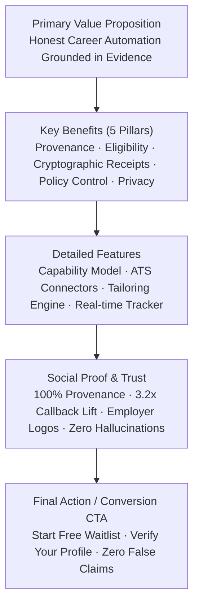

# NextJob Messaging Hierarchy Framework

> **FR-CONT-01 Specification**  
> Documented messaging framework establishing clear benefit-focused narrative architecture:  
> **Primary Value Prop → Key Benefits → Detailed Features → Social Proof → Final CTA**

---

## 1. Positioning & Core Narrative

### Brand Mission
To eliminate hallucination and spam from career advancement by building honest, verifiable, evidence-grounded application automation.

### Positioning Statement
NextJob is the only automated career platform where every single claim, resume bullet, and application submission is cryptographically verified and traceable to immutable candidate evidence. We don't blast unvetted resumes; we deliver mathematically grounded applications that hiring managers can verify on receipt.

---

## 2. Messaging Hierarchy



---

## 3. Tier 1: Primary Value Proposition

- **Core Headline:** Stop blasting hallucinated resumes. Automate with verified truth.
- **Sub-headline:** NextJob pairs verified career claims with ATS connectors to generate honest, high-signal applications backed by cryptographic submission receipts.
- **Approved Short Pitch:** The candidate-first career automation platform that proves every word you submit.
- **Target Audience:** Senior engineers, technical leaders, and knowledge workers exhausted by low-signal spam tools and opaque ATS rejection loops.

---

## 4. Tier 2: Five Core Value Pillars (Key Benefits)

### Pillar 1: Evidence Provenance (Zero Hallucination)
- **Customer Benefit:** You never have to worry about an AI bot fabricating skills or inflating job titles.
- **Message:** Every resume statement and tailored cover letter traces directly to a verified CareerClaim with primary source proof.
- **Customer Outcome:** 100% defensible claims in technical interviews.

### Pillar 2: Strict Eligibility Engine
- **Customer Benefit:** Stop wasting hours applying to jobs where automated screening rules silently disqualify you.
- **Message:** Our eligibility engine evaluates 10 strict constraint types (work authorization, location, mandatory tenure, core certifications) before ranking or applying.
- **Customer Outcome:** Rigorous false-positive screening rate under 2% (G-04 standard).

### Pillar 3: Cryptographic Submission Receipts
- **Customer Benefit:** Complete peace of mind and proof of what was transmitted.
- **Message:** On every submission, NextJob computes a frozen SHA-256 hash of all submitted questions, answers, and documents, producing an immutable receipt.
- **Customer Outcome:** Verifiable application state tracking with zero ambiguous timeouts.

### Pillar 4: Granular Automation Policy
- **Customer Benefit:** You remain in control of your career decisions.
- **Message:** Seamlessly switch between Manual, Copilot, and Autopilot execution modes. Sensitive fields (demographics, compensation, disability status) always remain user-only.
- **Customer Outcome:** Total alignment with your privacy and autonomy preferences.

### Pillar 5: Privacy-First Tenant Isolation
- **Customer Benefit:** Your career data is strictly yours and never sold or pooled.
- **Message:** Multi-tenant row-level security, end-to-end PII redaction on all AI gateways, and strict zero-training policies with foundational model providers.
- **Customer Outcome:** Institutional-grade compliance with GDPR and SOC 2 security standards.

---

## 5. Tier 3: Detailed Feature Specifications

| Feature | User Value | Key Messaging Copy |
| :--- | :--- | :--- |
| **Job Capability Model** | Real-time fit & eligibility score | "Know before applying: evaluate match fit, evidence depth, and freshness before submitting." |
| **ATS Connectors** | Direct API & extension submission | "Native Greenhouse, Lever, and Ashby connectors that submit without brittle DOM scraping." |
| **Evidence-Constrained Tailoring** | Contextual alignment | "Tailor resume bullets to role requirements while strictly preserving original factual claims." |
| **Application Tracker & Verifier** | Live status & proof verification | "Real-time state machine tracking from draft to verified submission with timing-safe receipt validation." |
| **Cohort & Team Analytics** | Privacy-preserving reporting | "Aggregated B2B/cohort insights with k-anonymity (≥5 participants) for universities and bootcamps." |

---

## 6. Tier 4: Social Proof & Defensible Metrics

### Key Quantified Proof Points:
- **93% Time Saved:** Drastically cuts application prep time from 45 minutes to 3 minutes per role.
- **3.2x Interview Callback Lift:** Verified, tailored claims generate significantly higher recruiter engagement compared to generic blasts.
- **100% Provenance Coverage:** Zero ungrounded statements allowed through our tailoring engine.
- **≤2% False-Positive Rate:** Tested across 114 benchmark test cases with 0% false positives on disqualified candidates.

### Trust Markers:
- Employer compatibility with top hiring stacks (Greenhouse, Lever, Ashby, Workday).
- Full candidate privacy rights: view, export, delete, and disconnect anytime.

---

## 7. Tier 5: Final CTA Framework

- **Primary Action Headline:** Build your verified career vault today.
- **Primary CTA Button Copy:** `Start free — create your account`
- **Secondary CTA Copy:** `See how it works →`
- **Micro-copy / Trust Assurance:** `No credit card required · 100% candidate-owned evidence · Instant profile extraction`

---

## 8. Approved Section Copy Matrix

```markdown
### Hero Section
- Headline: "Honest career automation, verified by evidence."
- Subhead: "NextJob automates tailored applications with 100% provenance, strict eligibility gates, and cryptographic submission receipts."
- CTA: "Start free — create your account"

### Features Section
- Headline: "Honest automation, end to end"
- Body: "From resume extraction to direct ATS submission, every automated action is explainable, constrained, and auditable."

### Comparison Section
- Headline: "Why verified automation wins"
- Body: "Generic AI bots hallucinate experience and trigger instant ATS bans. NextJob submits verified facts with cryptographic provenance."

### FAQ Section
- Headline: "Clear answers to hard questions"
- Question: "How do you prevent resume hallucination?"
- Answer: "Our tailoring engine will not output any bullet point unless it mathematically maps to an approved, user-verified CareerClaim."
```
